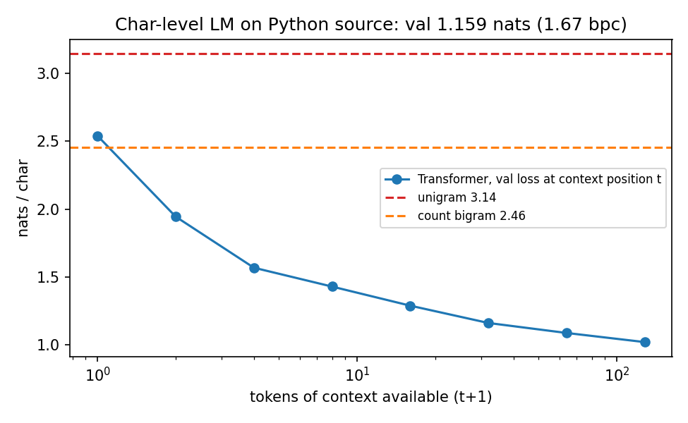
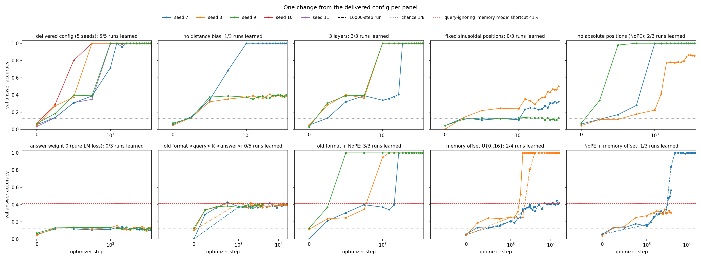
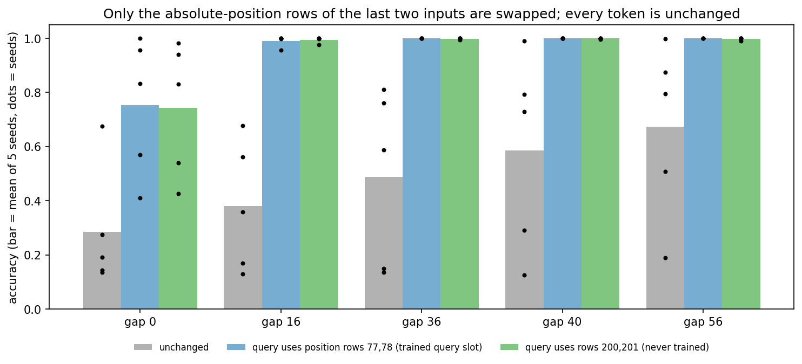
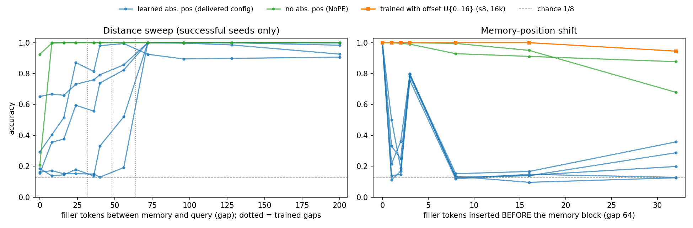

# 补充实验：交付模型到底学到了什么

`REPORT.md` 回答了"模型有没有用到远处信息"（有）。这里回答三个随后必然被问到的问题：**它是怎么用的？换个条件还成立吗？当初究竟是什么让它学会的？**

所有补充实验都**没有改动** `model.py / task.py / train.py / evaluate.py`。变体由 `followup/variants.py` 在外部替换模型或数据生成函数，训练仍调用原来的 `train.py`。交付权重 `runs/direct/model.pt` 也未改动。全部在 gps 环境、A100 上完成。

## 0. 结论更新

1. **原结论在同分布下成立，并且对随机种子稳健。**交付配置在 5 个 seed（7–11）上全部学会，每个 seed 的同分布准确率、相关值编辑跟随率和查询键编辑跟随率都是 100%。
2. **但检索是按绝对位置寻址的，不是按内容寻址。**记忆区整体右移 1 个 token，5 个 seed 都降到 11–50%；右移正好一条记录（3 个 token）时回升到 75–80%，因为 4 条记录里有 3 条落回了训练时的位置 3/6/9/12。
3. **在没见过的长度上失败，原因是查询位置的绝对位置向量，而不是距离。**token 一个都不动，只替换最后两个输入的位置向量行，gap 16–56 的准确率就从平均 38–67% 恢复到 99–100%。
4. **学会与否由两件事决定：答案位置的格式（`<answer>` 标记）和答案加权**，并且格式和"可学习绝对位置编码"之间存在交互。原格式加可学习位置，5 次运行全部失败，包括 4 倍步数；同样的原格式去掉绝对位置编码后，3/3 学会。这是本轮**先写下预测、再做实验**的检验。
5. 去掉绝对位置编码（NoPE，保留距离偏置）后，同一份固定布局的训练数据学出的检索对记忆区平移和距离基本不变。

## 1. 复现核验（`followup/results/reproduction.json`）

| 检查 | 结果 |
|---|---|
| 用 README 命令在 `cuda:1` 上重训，权重是否与 `runs/direct/model.pt` 逐位相同 | **是** |
| 4001 行训练日志（除耗时外） | **完全一致**（核验时日志尚在；仓库不再附带日志） |
| 重跑 `evaluate.py` 后与 `runs/direct/results.json` 对比 | 只有 checkpoint 路径字符串不同，所有数值相同 |
| 训练耗时 | 单独运行 83 s；8 个任务并发时约 2.5–5 min（瓶颈在 CPU 调度，不在 GPU） |

`pytest -q test_core.py`：11 passed。

## 2. 真实文本上的完整性检查（`followup/charlm.py`、`results/charlm.json`）

题目要求先实现并训练一个语言模型。原交付只在 20 个 token 的合成语言上训练过。这里用**完全不改的** `TransformerLM / AdamW / clip_grad_norm / token_cross_entropy`，在 Python 标准库源码上训练了一个字符级 LM。节点没有外网，所以用本地源码代替 tiny-shakespeare：475 万字符，213 个符号，按文件顺序切分出连续、不重叠的后 10% 作验证集。模型 4 层、宽度 128、88 万参数、上下文 128，训练 3000 步，约 2.5 分钟。

| 验证集 nats/字符 | 值 |
|---|---:|
| unigram（计数） | 3.144 |
| bigram（计数） | 2.455 |
| **Transformer** | **1.159**（1.67 bits/char） |

在上下文中第 t 个位置的验证 loss 随可见前文增多单调下降：位置 0 为 2.54，1 为 1.94，7 为 1.43，31 为 1.16，127 为 1.02。说明模型真的在利用前文，而不只是记住了 bigram。温度 0.8 的生成样本里，缩进、`self.xxx`、`def`、docstring 等结构都正确（见 JSON）。小瑕疵：字符表取自全文，包括验证集，只影响符号集合，不影响结论。



## 3. 单变量消融：什么决定能否学会（`results/generalization.json`）

每一项**只改动交付配置中的一处**，训练 4000 步。"学会"指最终验证准确率 ≥ 99%。

| 变体 | 学会的运行数 | 最终验证准确率（按 seed） | 首次 ≥99% 的步数 |
|---|---:|---|---|
| 交付配置（seed 7–11） | **5/5** | 全部 1.00 | 750–1250 |
| 去掉距离偏置（slope 全为 0） | 1/3 | 1.00 / 0.39 / 0.40 | 1000 |
| 3 层 | 3/3 | 1.00 ×3 | 1000–2000 |
| 固定正弦位置编码（单位幅度） | 0/3 | 0.32 / 0.50 / 0.13 | — |
| 无绝对位置编码（NoPE） | 2/3 | 1.00 / 0.85 / 1.00 | 750–1000 |
| answer_weight = 0（纯 LM 平均 loss） | 0/3 | 0.10 / 0.13 / 0.12 | — |
| **原格式 `<query> K <answer> V`** | **0/3** | 0.40 / 0.36 / 0.41 | — |
| 原格式，16000 步（4 倍预算） | **0/2** | 0.41 / 0.39 | — |
| **原格式 + NoPE** | **3/3** | 1.00 ×3 | 500–1750 |
| 记忆区前插随机 0–16 个 token | 1/2 | 0.37 / 1.00 | 2000 |
| 同上，16000 步 | 1/2 | 0.42 / 1.00 | 4000 |
| NoPE + 记忆区随机偏移 | 0/2 | 0.57 / 0.31 | — |
| 同上，16000 步（seed 7） | 1/1 | 1.00 | 5000 |



关于统计强度，每组只有 2–5 个 seed。按单侧 Fisher 精确检验：
- 原格式、正弦位置、answer_weight=0 与交付配置相比（0/3 对 5/5），p ≈ 0.018。
- 原格式 + NoPE 与原格式相比（3/3 对 0/3），p = 0.05。
- 去掉距离偏置（1/3 对 5/5），p ≈ 0.11，**只算提示，不能算结论**。
- NoPE（2/3 对 5/5），p ≈ 0.38，与交付配置没有可区分的差异。

读法：
- **失败的运行几乎都停在约 40%**，这正是"忽略查询键、猜记忆值众数"的理论上限 41.2%（每个模型的查询键编辑跟随率也约 0.4，说明它们不看查询键）。交付配置自己在第 500–750 步也经过这个平台（31–39%），随后才突然跳到 100%。
- answer_weight=0 的运行**连众数捷径都没学到**（≈12.5%）。答案只占 79 个预测位置中的 1 个，纯平均 loss 下这个信号太弱，至少 4000 步内不够。
- 正弦位置的失败**不能归因于"正弦"本身**。这里的正弦向量幅度为 1（范数约 5.7），而内容向量 `0.02·√64` 的初始范数约 1.3，位置信号在初始化时压过了内容。这个尺度混淆没有拆开测。

## 4. 模型学到了什么：按绝对位置寻址

### 4.1 记忆区平移（gap 固定为 64，在 `<bos>` 和记忆区之间插入 k 个随机值）

| 前插 token 数 k | 0 | 1 | 2 | **3** | 8 | 16 | 32 |
|---|---:|---:|---:|---:|---:|---:|---:|
| 交付配置，5 个 seed 的范围 | 1.00 | 0.11–0.50 | 0.15–0.36 | **0.75–0.80** | 0.12–0.15 | 0.10–0.17 | 0.12–0.36 |
| 3 层，3 个 seed | 1.00 | 0.07–0.40 | 0.04–0.26 | 0.66–0.79 | 0.04–0.13 | 0.04–0.12 | 0.04–0.14 |
| NoPE（学会的 s7 / s9） | 1.00 | 1.00 / 1.00 | 1.00 / 1.00 | 0.99 / 1.00 | 0.93 / 1.00 | 0.91 / 0.95 | 0.88 / 0.68 |
| 原格式 + NoPE（s7 / s8 / s9） | 1.00 | 1.00 / 1.00 / 1.00 | 0.98 / 1.00 / 1.00 | 0.94 / 1.00 / 1.00 | 0.89 / 1.00 / 1.00 | 0.90 / 1.00 / 0.98 | 0.88 / 1.00 / 0.95 |
| 用随机偏移训练（s8，16k 步） | 1.00 | 1.00 | 1.00 | 1.00 | 1.00 | 1.00 | 0.95 |

k=3 这个"回升尖峰"是诊断性的：如果是按内容检索，k=1 和 k=3 不该有区别；如果是按地址检索，k=3 时正好有 3/4 的记录落回原地址，预期约 0.75 + 0.25 × 1/8 ≈ 0.78，与实测 0.75–0.80 吻合。增加到 3 层不会消除这种依赖。

### 4.2 注意力：绑定和检索在哪里断掉（交付模型，`results/attention.json`）

第 1 层的 L1 列表示"值位置 → 它前面那个键"的注意力，也就是键和值的绑定。第 2 层的 L2 列表示"查询位置 → 正确源值"的注意力，也就是检索。

| 条件 | 准确率 | L1 head0（slope 0） | L1 head2（slope 0.5） | L2 head0 | L2 head1 |
|---|---:|---:|---:|---:|---:|
| gap 64，原位置 | 1.00 | **0.991** | 0.963 | 0.847 | 0.966 |
| gap 64，记忆区右移 1 | 0.12 | **0.065** | 0.216 | 0.006 | 0.005 |
| gap 0 | 0.24 | 0.991 | 0.963 | 0.035 | 0.165 |
| gap 36 | 0.80 | 0.991 | 0.963 | 0.553 | 0.759 |
| gap 96 | 0.91 | 0.991 | 0.963 | 0.710 | 0.869 |

- 负责绑定的主力 head0 **没有距离偏置**，它对"前一个 token"0.991 的注意力完全靠可学习的绝对位置实现。右移 1 格后，这个注意力掉到 0.065，绑定断开，第 2 层也就找不到源值。
- 在 gap 变化时，绑定始终完好（0.991），坏掉的是第 2 层的检索。这引出第 5 节的干预。
- 这是相关性证据。因果证据见 4.1 的平移实验和第 5 节。

## 5. 没见过的长度为什么失败：替换位置向量行（`followup/position_swap.py`）

现象：多个 seed 在 gap 36/40/56（训练范围内但没见过）上明显差于 gap 72–200（超出训练长度）。5 个 seed 中，gap 40 的准确率在 0.13–0.98 之间，gap 72–200 却在 0.89–1.00 之间。原报告"未见中间长度 98%/99.5%"只是 seed 7 的情况。

假设：可学习的位置行编码了"训练时这个位置上放的是什么角色"。gap 为 36/40/56 时，查询落在训练中一直放干扰值的位置上，那几行位置向量干扰了检索；gap ≥ 72 时查询落在**从未训练过的行**（第 79 行以后）上，这些行近似中性。

干预：**token 一个都不动**，只把最后两个输入（`<query>`、K）使用的位置向量换成别的行。

| gap | 不改（5 个 seed 平均 / 最低） | 换成第 77、78 行（训练时查询的位置） | 换成第 200、201 行（从未训练） |
|---:|---:|---:|---:|
| 0 | 0.28 / 0.13 | 0.75 / 0.41 | 0.74 / 0.43 |
| 16 | 0.38 / 0.13 | 0.99 / 0.96 | 0.99 / 0.98 |
| 36 | 0.49 / 0.13 | **1.00 / 1.00** | 1.00 / 0.99 |
| 40 | 0.59 / 0.13 | **1.00 / 1.00** | 1.00 / 1.00 |
| 56 | 0.67 / 0.19 | **1.00 / 1.00** | 1.00 / 0.99 |

反方向也成立：在训练过的 gap 64 上，把查询的位置向量换成训练时放干扰值的第 50、51 行，5 个 seed 的准确率从 1.00 降到 0.89 / 0.80 / 0.24 / 0.15 / 0.66。



结论：gap 16–56 的失败**完全**由查询位置的位置向量造成，与距离无关。gap 0 只恢复了一部分（0.28→0.75），说明还有别的因素，见第 9 节。



## 6. 原格式为什么失败：一次先预测后验证

先排除"训练预算不足"：原格式在 16000 步（4 倍）时验证准确率仍然平坦，保持在 0.39–0.41。

机制性假设：可学习绝对位置配置只在**存在绝对位置解法**的地方成功。
- 直接格式下，键值绑定发生在固定位置 3/6/9/12，可以用绝对位置做；查询键本身就在预测位置上，不需要相对位置操作。
- 原格式下，`<answer>` 的位置随长度变化，它必须从"前一个 token"取回查询键。这是一个在可变位置上的相对位置操作，可学习绝对位置并不能直接提供。

预测：去掉绝对位置编码，让模型只能使用相对位置（距离偏置），原格式就应该能学会。

结果：**3/3 学会**（500–1750 步），而且学到的检索同样对平移不变（见 4.1）。这支持上面的假设，但**不等于证明**。也可能是 NoPE 让原格式的优化地形整体变得更平滑，而原因并不是"相对位置操作"。区分这两种解释需要电路分析，比如检查原格式 + NoPE 模型的第 1 层，在 `<answer>` 位置是否由 slope 0.5/1 的头完成取回前一个 token 的操作。

## 7. 打乱记忆区位置训练

- 可学习位置 + 随机偏移：seed 8 在两种预算下都学会了，学到的检索在偏移 0–16 内对平移不变；seed 7 在两种预算下都停在众数平台。同一个 seed 在 4k 和 16k 步下结果一致。说明这是**依赖初始化的成败**，不是简单的预算问题。
- NoPE + 随机偏移：4k 步时 0/2，seed 7 延长到 16k 步后在第 5000 步学会。这一组的失败是**预算不足**。
- 交付模型在没有打乱的数据上 750–1250 步就学会了，因为固定布局给了它一条更便宜的绝对地址解法。

## 8. 判断发生过的变化

| 之前的判断 | 证据 | 现在的判断 |
|---|---|---|
| 模型"利用了远处信息" | 平移 1 格降到随机 | 在固定布局下按**绝对地址**利用远处信息 |
| 没见过的中间长度约 98% | 5 个 seed 在 gap 40 上为 0.13–0.98 | 单个 seed 的偶然结果；原因是查询位置的位置向量（因果干预确认） |
| 原格式失败可能是没跨过平台期 | 16000 步仍是 0.40 | 否定。是原格式与可学习绝对位置之间的交互，且 NoPE 预测已被验证 |
| 无法说明是哪个改动带来成功 | 单变量消融 | 格式和 answer_weight 是决定性的，3 层和距离偏置不是必要条件 |
| （补充中途）单 seed 下去掉距离偏置也能成功，所以它不必要 | 3 个 seed 只有 1/3 | 它可能提升可靠性（p≈0.11，样本太少，不能下结论） |
| （补充中途）单 seed 下打乱位置就学不会 | 另一个 seed 4k 步就学会了 | 依赖 seed；NoPE 版本则是预算问题 |

后两行是补充实验过程中，单 seed 结论被更多 seed 推翻的例子。这也是本节所有结论都标出 seed 数的原因。

## 9. 仍然不知道的

- **gap 0 为什么失败**：替换位置向量后只恢复到平均 0.75。可能和记忆区与查询紧贴时，带距离偏置的头或近邻干扰有关，没有验证。
- **距离偏置是否真的提高了成功率**：1/3 对 5/5，需要更多 seed。
- **NoPE 模型的电路**：只有行为证据（平移不变），没有看注意力，没有验证它确实用带距离偏置的头做"取前一个 token"。
- **正弦位置失败是否只是尺度问题**：没有测缩小幅度的正弦编码。
- **纯 LM 目标（answer_weight=0）在更长训练下能否学会**：没有测。
- **为什么随机偏移下 seed 7 学不会而 seed 8 能学会**：只知道和预算无关。
- **样本量**：每组 2–5 个 seed，结论标的是方向，不是精确效应大小。

**什么证据会推翻第 0 节的结论？**
- 如果某个 seed 的交付配置模型在平移 1 格后仍接近 100%，"按地址寻址"就不是普遍结论。
- 如果替换位置向量后 gap 36–56 没有恢复，第 5 节就不成立。
- 如果原格式 + 可学习位置在更长训练（比如 50k 步）或换学习率后能学会，第 6 节就只是"更难"，而不是"缺一种机制"。

## 10. 改变一个变量时的预测（面试速查）

| 对交付模型或配置做的改动 | 预测 | 依据 |
|---|---|---|
| 记忆区右移 1、2、8 个 token | 接近随机（0.1–0.5） | 第 4 节，5/5 seed |
| 记忆区右移 3 个 token | 约 0.78 | 3/4 的记录落回原地址 |
| gap 缩短到 0–24 | 明显下降，seed 间差异很大 | 查询位置的位置向量（第 5 节） |
| gap 设为 36、40、56 | 不一定好，可能比 gap 100 还差 | 同上 |
| gap 72–200 | 0.9–1.0，不随距离下降 | 查询位于未训练的中性位置行；slope 0 的头没有距离惩罚 |
| gap > 241 | 无法运行 | `max_seq_len=256` 触发 assert |
| 改成 NoPE 重训 | 大概率学会，并且对平移和距离基本不变 | 2/3（第 3、4 节） |
| 换回 `<answer>` 格式 | 停在约 40% 的众数平台 | 0/5 |
| `<answer>` 格式 + NoPE | 学会 | 3/3 |
| answer_weight=0 | 4000 步内学不会 | 0/3 |
| 加到 3 层 | 能学会，但平移依然崩 | 3/3；平移 1 格为 0.07–0.40 |

## 11. 复现

```bash
# 在仓库根目录（taska/）下、用装好 requirements.txt 的 Python 环境运行
python followup/run_jobs.py --gpus 1,2,3,7 --workers 8        # 可选：重训 jobs.txt 中的全部变体（约 25–35 分钟）；仓库已附带权重
python followup/probe_generalization.py cuda:1 | tee followup/results/generalization_table.txt   # -> generalization.json, val_curves.json
python followup/position_swap.py cuda:1                       # -> results/position_swap.json
python followup/attention_probe.py cuda:1                     # -> results/attention.json
python followup/charlm.py cuda:1                              # -> results/charlm.json（约 2.5 分钟）
python followup/make_figures.py                               # -> figures/*.png
# 复现核验（README 命令，输出写到 /tmp，不覆盖交付文件）
CUBLAS_WORKSPACE_CONFIG=:4096:8 python train.py --device cuda:1 --out /tmp/reproduce
python evaluate.py --checkpoint runs/direct/model.pt --device cuda:1 --out /tmp/eval_delivered
python followup/verify_reproduction.py /tmp/reproduce /tmp/eval_delivered
```

`followup/runs/<变体>_s<seed>/` 下只保存 `model.pt`（权重和训练参数）和 `variant.json`（变体设置），所有分析脚本可直接加载，不需要重训。逐步训练日志不随仓库发布；各次运行的验证曲线保存在 `results/val_curves.json`，重训时会重新生成日志。`default_s7` 就是交付模型 `runs/direct`，没有重复存放。
