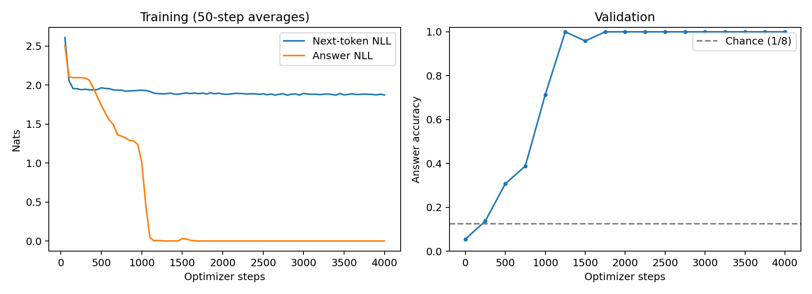
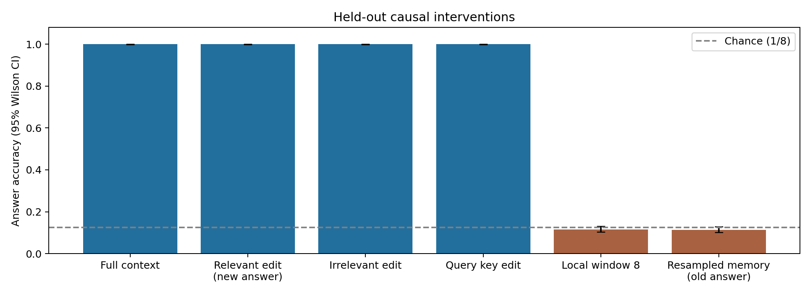

# 实际训练与上下文验证报告

结论：**交付模型在本任务中确实利用了远处、与查询键相关的信息**。证据来自独立测试和配对输入干预，不仅是 loss 下降。结论限定于下面的合成数据分布；长度外推并不完美。

> **补充实验（[FOLLOWUP.md](FOLLOWUP.md)）对上述结论的限定与扩展：**① 成功对随机种子稳健（5/5 seed）；② 检索是**按绝对位置寻址**的：记忆区右移 1 个 token，准确率降到 11–50%（5 个 seed），去掉绝对位置编码后则学到对平移不变的检索；③ 没见过长度上的失败由查询位置的位置向量造成（替换位置向量行的因果干预）；④ 单变量消融表明，`<answer>` 格式与可学习绝对位置组合时会失败（5 次运行全失败，含 4 倍步数），原格式改用 NoPE 后 3/3 学会；此外 answer_weight 是必要的。另外在真实文本（字符级 Python 源码）上训练同一实现，验证 loss 为 1.159 nats/字符，低于 bigram 的 2.455。

## 实现与训练

- 环境：`/mnt/workspace/Wilson/miniconda3/envs/gps/bin/python`，Python 3.10.18，PyTorch 2.7.1+cu126。
- 设备：NVIDIA A100-SXM4-80GB。最初在 `cuda:6` 上训练；整理代码后，用当前代码的默认参数在 `cuda:1` 上重训，得到的权重与原 checkpoint 逐位相同，训练日志除耗时外完全一致，所有测试指标也完全一致。
- 结构：2 层 decoder-only Transformer，4 头，每头 16 维，隐藏宽度 64，MLP 宽度 256，20-token 词表，**119,040 参数**。
- 可学习绝对位置表；四头距离偏置 slope 为 `[0,0,0.5,1]`，前两头允许无距离惩罚的远处检索。没有预训练权重或现成 Transformer/attention 封装。
- 核心层、交叉熵、AdamW 与梯度裁剪手写。反向求导使用 PyTorch autograd，未声称手写自动微分引擎。
- 固定 seed=7，4000 步，batch=64，共 256,000 条在线生成训练样本。单次训练在 A100 上约 1.5–2.5 分钟，具体取决于 GPU 负载。
- 目标：`全序列 next-token NLL + 2 × 最后答案 NLL`；AdamW 峰值学习率 0.0015、50 步 warmup、余弦下降、全局梯度裁剪 1.0。
- 训练 gap 为 32/48/64，验证 RNG seed=20001；最终测试 seed=30001，穷举反事实 seed=40001。配置调整只看验证集；测试在训练结束后执行，没有根据测试结果继续调参。

## 任务与无泄漏约束

输入格式为 `<bos> (<store> K V)×4 [随机干扰值] <query> K`，预测紧随其后的 V。每个样本重新生成 4 个不同键、4 个独立随机值以及噪声，查询槽位独立均匀随机。正确值与答案位置在训练分布中相隔 35–76 个 token。主测试包含 64 个干扰 token，正确值与答案相隔 **67–76 个 token**。

`x=s[:-1]`、`y=s[1:]`；答案只在监督标签中。三角遮罩阻断未来信息，每个 LayerNorm/MLP 都不沿时间维混合。完整词表 20 项参与 argmax，未将候选答案硬裁成 8 类。

仅凭不含记忆区的后缀，答案在 8 个值中条件均匀，理论准确率 12.5%。但看记忆区、忽略查询键的“猜众数”基线可以达到约 40%，所以“超过 12.5%”本身不足以证明按键检索。

## 主测试与配对干预

全部条件使用同一批 2048 个独立测试样本。区间为按样本计算的 95% Wilson 区间；它描述固定模型的测试抽样不确定性，不代表训练随机种子之间的波动。

| 条件 | 正确/总数 | 准确率或一致率 | 95% 区间 |
|---|---:|---:|---:|
| 完整上下文 | 2048/2048 | 100.00% | 99.81%–100.00% |
| 仅改正确源值：预测新答案 | 2048/2048 | 100.00% | 99.81%–100.00% |
| 原样本与相关值编辑样本都答对 | 2048/2048 | 100.00% | 99.81%–100.00% |
| 仅改无关键的值：答案仍正确 | 2048/2048 | 100.00% | 99.81%–100.00% |
| 仅改无关键的值：预测保持不变 | 2048/2048 | 100.00% | 99.81%–100.00% |
| 仅改查询键：预测另一键的值 | 2048/2048 | 100.00% | 99.81%–100.00% |
| 每层只看最近 8 个 token | 238/2048 | 11.62% | 10.30%–13.08% |
| 重采样全部记忆值：对旧答案评分 | 234/2048 | 11.43% | 10.12%–12.88% |
| 重采样全部记忆值：对新答案评分 | 2048/2048 | 100.00% | 99.81%–100.00% |
| 直接猜最后一个干扰 token | 255/2048 | 12.45% | 11.09%–13.95% |
| 忽略查询键：猜记忆值众数 | 838/2048 | 40.92% | 38.81%–43.06% |

随机初始化、尚未训练的同配置模型在完整词表上准确率为 5.08%。它可能输出键或控制符，因此不必接近“只从 8 个值中猜”的 12.5%。

相关值编辑只改变一个远处 token，整个后缀不变；新值一定不同于原值。无关值编辑改变另一个键的值。查询编辑只改变最后的查询键。重采样记忆值仍产生合法任务输入，对旧标签降至随机附近、对新标签保持正确，进一步支持信息确实来自当前记忆。

每层窗口 8 包含当前位置和前 7 个位置，两层最大向前感受野 14，无法通过中间 token 接力到达源值。评估额外断言：这个局部模型在远处相关值被替换前后，最后的 logits 完全相同。窗口消融存在分布改变，但其他保持有效任务格式的干预补足了这一限制。

## 相同后缀的八答案穷举

构造 256 组独立基础输入，每组只把正确源位置遍历 V0…V7，后缀以及其他 token 全部一致。共有 2048 个变体，变体准确率 **100.00%**；**256/256 组八个全对**，按组计算的 95% 区间为 98.52%–100.00%。

只看后缀的确定性预测器对同组 8 个输入只能输出相同答案，最多答对 1 个，不能通过这个检查。组内变体相关，因此没有把 2048 个变体当作独立样本计算二项置信区间。

第一个主测试样本查询 K0：源值 V5，预测 V5；只把该源值改成 V6，预测跟着变为 V6。这个例子按数据顺序选取，没有挑选成功样本。

## 长度泛化与 loss

| 干扰 token 数 | 源值到答案的距离 | 类型 | 正确/总数 | 准确率 |
|---:|---:|---|---:|---:|
| 32 | 35–44 | 训练出现过的长度，新样本 | 1024/1024 | 100.00% |
| 40 | 43–52 | 未见中间长度 | 1004/1024 | 98.05% |
| 48 | 51–60 | 训练出现过的长度，新样本 | 1024/1024 | 100.00% |
| 56 | 59–68 | 未见中间长度 | 1019/1024 | 99.51% |
| 64 | 67–76 | 训练出现过的长度，新样本 | 2048/2048 | 100.00% |
| 96 | 99–108 | 长度外推 | 912/1024 | 89.06% |
| 128 | 131–140 | 长度外推 | 931/1024 | 90.92% |

主测试答案 NLL 为 **0.00017638** nats；全序列 NLL 为 **1.931617**，perplexity 为 **6.9007**。随机干扰值本身不可预测，所以全序列 loss 不趋近零并不意味着检索失败。反过来，只学会格式和常见 token 也能降低全序列 loss，不能据此宣称学会检索。

长度 40/56 从未作为训练 gap 出现；96/128 超出训练最大 gap=64，结果约 89%–91%，明确低于同分布表现。不能把这次成功解释为任意长度泛化。

> 补充：上表只是 seed 7 的结果。在 5 个 seed 上，gap 40 的准确率为 0.13–0.98，gap 36 为 0.14–0.81，gap 0 为 0.15–0.65，而 gap 72–200 为 0.89–1.00。只替换查询位置的位置向量行，gap 16–56 即恢复到 99–100%，所以失败与距离无关，见 [FOLLOWUP.md §5](FOLLOWUP.md)。

## 失败试验与验证

| 目录（仅 `runs/direct` 保留） | 配置摘要 | 步数 | 最终验证答案准确率 |
|---|---|---:|---:|
| `runs/main` | 2 层，正弦位置，CPU | 1600 | 31.51% |
| `runs/gpu` | 2 层，正弦位置，GPU | 5000 | 35.42% |
| `runs/gpu_3layer` | 3 层，正弦位置 | 6000 | 38.80% |
| `runs/final` | 3 层，可学习位置 | 4000 | 41.93% |
| `runs/relative` | 3 层，可学习位置＋距离偏置 | 4000 | 41.93% |
| `runs/direct` | 2 层，可学习位置＋距离偏置，直接查询 | 4000 | 100.00% |

前五轮使用 `<query> K <answer> V` 格式，最后一轮使用 `<query> K V`，去掉额外输出标记；远处随机映射、噪声、查询分布未改变。模型层数、位置编码、学习率、损失权重和训练预算也曾调整，**这不是只改变一个变量的对照试验**，不能声称已单独证明哪个改动造成成功。约 40% 的结果不包装成检索成功；它接近上表中“忽略查询键、猜记忆值众数”的 40.92% 基线，但没有对这些模型做干预实验，不能断定它们学到的就是这个捷径。前五轮的权重和日志以及旧格式代码已在整理代码库时移除，表中数字取自各自 `history.jsonl` 的最后一行。

> 补充：之后在当前配置上做了单变量对照（[FOLLOWUP.md §3、§6](FOLLOWUP.md)）。只把格式改回 `<query> K <answer> V`，3/3 seed 停在约 40%，16000 步仍为 0/2；同一格式去掉绝对位置编码后 3/3 学会。约 40% 的平台与"猜众数"上限 41.2% 一致，这些模型的查询键编辑跟随率也约为 0.4，说明它们不看查询键。

11 项自动检查通过（`test_core.py`）：手写 loss 的值与梯度和参考交叉熵一致、LayerNorm 对照、attention（含因果遮罩与距离偏置）与 `F.scaled_dot_product_attention` 对照、整块有限差分、选定参数有限差分、未来 token 对过去 logits 与梯度无影响、两/三层局部窗口无法接力到记忆区、AdamW 多步数值对照、梯度裁剪与数据 shift 及干预约束、常数猜测器必须通不过穷举验收。参考封装只用于测试，不进入训练网络。

局限：最终成功配置只训练了一个随机种子；记忆区总在开头、键词表固定为 8 个、记录数固定为 4。尚未证明记忆区平移、更多键/记录、自然语言、多轮生成或更长距离的泛化，也未定位具体注意力头的电路。该模型是合成符号语言的自回归 LM，不是自然语言聊天模型。

> 补充实验已覆盖其中几项（[FOLLOWUP.md](FOLLOWUP.md)）：多 seed（5/5 成功）；记忆区平移（**失败**，原因是按绝对位置寻址）；逐头注意力（第 1 层 head0 负责键值绑定，第 2 层 head0/1 负责检索）；真实文本上的字符级 LM。更多键或记录、多轮生成仍未测试。

## 产物与复现

- [完整使用说明](README.md) / [逐段数学与代码讲解](WALKTHROUGH.md) / [补充实验](FOLLOWUP.md)
- [核心实现](model.py) / [测试脚本](test_core.py)
- [交付权重](runs/direct/model.pt) / [原始测试数据](runs/direct/results.json)
- [训练曲线](runs/direct/training.png) / [首次反传各参数梯度](runs/direct/first_backward.json)（逐步训练日志不随仓库发布，可用下方复现命令逐位重新生成）
- checkpoint SHA-256：`d1c6e77b106990b7a830b2b7c04284c35927b7451a30d630aefa2672d71acf4f`（文件哈希包含元数据；权重张量与最初训练的 checkpoint 逐位相同）
- 复现：`CUBLAS_WORKSPACE_CONFIG=:4096:8 python train.py --device cuda:1`，再运行 `python evaluate.py --checkpoint runs/reproduce/model.pt --device cuda:1`

